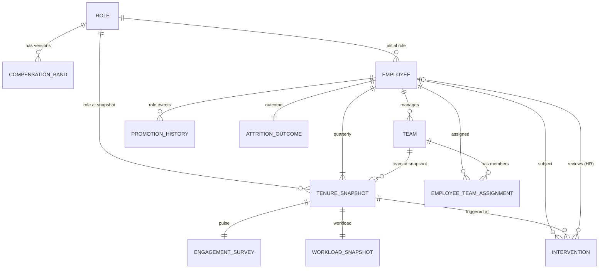

# Design Decisions

Companion to `data_dictionary.md`. Written in Phase 1, before any generator code, and updated if decisions change (changes are logged in section 13).

## 1. Purpose and principles

The system produces **supportive signals** that help HR partners and managers prioritise retention conversations. It never makes an employment decision.

1. **Rules, not dice.** Attrition, interventions and their effects come from documented functions of earlier data, plus a documented unobserved noise term.
2. **Parents first.** Master tables are generated before dependent tables, so every FK is valid by construction.
3. **Derived, not drawn.** Totals, ratios, scores, labels and statuses are computed from source rows.
4. **Append-only history.** State changes are new rows or dated stages.
5. **As-of correctness.** A feature is usable at cutoff `C` only if `recorded_at <= C`.
6. **Honest labels.** Injected anomalies are tagged in a separate ground-truth file. Unrelated rows are never silently corrupted.

## 2. Timeline and temporal evaluation

| Item | Value |
|---|---|
| Window | 2024-10-01 to 2026-09-30 (24 months, 8 quarterly snapshots) |
| Quarters | 2024Q4, 2025Q1, 2025Q2, 2025Q3, 2025Q4, 2026Q1, 2026Q2, 2026Q3 |
| Horizon | 6 months after the cutoff |
| Train cutoff | 2025-03-31, labels from 2025-04-01 to 2025-09-30 |
| Validation cutoff | 2025-09-30, labels from 2025-10-01 to 2026-03-31 |
| Test cutoff | 2026-03-31, labels from 2026-04-01 to 2026-09-30 |

Rules:
- Features for a cutoff use only rows with `recorded_at <= cutoff`.
- Each earlier horizon ends no later than the next cutoff, so training labels are fully observed before the test period.
- Split is by time. Employees appear in several cutoffs, which is allowed because each cutoff is a separate prediction moment. Never split randomly.
- The test cutoff gives the stored label in `AttritionOutcome`. Train and validation labels are recomputed from `termination_date` by the same function.

Why this window: it lies entirely before today's date and includes 2026Q1 (the ID example in the brief). I first floated 2025Q1 to 2026Q4. I changed it so no record is dated in the future.

## 3. ID conventions

| Entity | Format | Example | Notes |
|---|---|---|---|
| Employee | `EMP-` + 6 digits | `EMP-000001` | Brief |
| TenureSnapshot | `SNAP-<employee_id>-<YYYYQn>` | `SNAP-EMP-000001-2026Q1` | Brief |
| EngagementSurvey | `SURV-<year>-<6 digits>` | `SURV-2026-000001` | Brief; counter restarts each year |
| Intervention | `INT-<year>-<6 digits>` | `INT-2026-000001` | Brief; counter restarts each year |
| AttritionOutcome | `OUT-<employee_id>-2026` | `OUT-EMP-000001-2026` | Brief |
| Role | `ROLE-` + 3 digits | `ROLE-003` | Mine |
| Team | `TEAM-` + 4 digits | `TEAM-0012` | Mine |
| CompensationBand | `BAND-<role no>-<FY start year>` | `BAND-003-2025` | Mine |
| WorkloadSnapshot | `WKL-<employee_id>-<YYYYQn>` | `WKL-EMP-000001-2026Q1` | Mine |
| PromotionHistory | `PRM-` + 6 digits | `PRM-000001` | Mine |
| EmployeeTeamAssignment | `ASG-` + 6 digits | `ASG-000001` | Mine |
| GroundTruth | `GT-` + 6 digits | `GT-000001` | Mine |

IDs are pure functions of their inputs and are immutable. Counters are assigned in sorted order, so they are deterministic. Helpers live in `src/yottaflex/ids.py`.

## 4. Entity relationships



| Relationship | Cardinality | Optional? | Notes |
|---|---|---|---|
| Role - CompensationBand | 1 : N | No | 3 effective-dated versions per role |
| Role - Employee (initial role) | 1 : N | No | Later roles come from PromotionHistory |
| Employee - Team | **N : M** via EmployeeTeamAssignment | No | Effective-dated; transfers add rows |
| Employee - Team (manages) | 1 : N | Team always has a manager | Manager is an Employee |
| Employee - TenureSnapshot | 1 : N (>= 1) | No | One row per active quarter-end |
| TenureSnapshot - EngagementSurvey | 1 : 1 | No | Row exists even when skipped |
| TenureSnapshot - WorkloadSnapshot | 1 : 1 | No | - |
| Employee - PromotionHistory | 1 : N (>= 0) | Yes | - |
| Employee - AttritionOutcome | 1 : 1 | No | Status `Active` when no exit |
| Employee - Intervention | 1 : N (>= 0) | Yes | - |
| TenureSnapshot - Intervention | 1 : N (>= 0) | Yes | Traceability to the evidence at trigger time |
| Employee (HR) - Intervention (reviewer) | 1 : N (>= 0) | Yes | Required once reviewed |

Join validation (Phase 4): every FK resolves, every 1:1 has exactly one partner, and snapshot, survey and workload agree on employee and quarter.

## 5. Lifecycle states

**Employee:** `Hired -> Active -> Exited_Voluntary` or `Exited_Involuntary`. Terminal states have no outgoing transitions. Transfers and promotions are events, not states. Rules: first snapshot date < termination_date; no snapshots after termination_date.

**Survey:** `Invited -> Responded` or `Partial` or `Skipped`. Skipped means null scores.

**Intervention:**
- `Proposed -> Approved -> Conducted -> Closed`
- `Proposed -> Declined` (terminal)
- Signal_Flagged items must pass review (`Approved`) before `Conducted`.
- Manager_Initiated and HR_Initiated items may use `review_status = Not_Required`.
- Stage dates must be non-decreasing.

**Assignment:** contiguous, non-overlapping per employee; the last one closes on termination.

## 6. Generation order

1. **Masters:** Role, CompensationBand (3 versions), Employee (hire dates, initial role), Team (managers drawn from Employee with level >= 4 in the same family), initial EmployeeTeamAssignment.
2. **Pre-window history:** PromotionHistory events and salary before 2024-10-01 so tenure and stagnation are realistic at the start.
3. **Quarter loop (2024Q4 to 2026Q3), sequential:**
   - a. create TenureSnapshot, WorkloadSnapshot, EngagementSurvey for active employees
   - b. compute the rule-based risk (section 7) from rows already recorded
   - c. create Interventions (trigger rules below) and apply simulated effects
   - d. draw voluntary and involuntary exits for the *next* quarter from the hazard
   - e. apply internal transfers and promotions (new rows)
4. **AttritionOutcome:** derived from termination facts; label via one function.
5. **Anomaly injection** (section 9), then ground_truth.
6. **Validation, exports, checksums.**

The loop is sequential because interventions depend on earlier snapshots and later hazards depend on interventions. Each step inside a quarter is vectorised over employees.

## 7. Risk rule (documented ground-truth mechanism)

Hazard of a voluntary exit during quarter `q`, using only data recorded by the end of `q-1`:

```
logit(h) = b0
         + 0.90 * eng_gap
         + 0.40 * eng_drop
         + 0.60 * stagnation
         + 0.70 * pay_gap
         + 0.80 * overload_eff
         + 0.50 * early_tenure
         + eps_i                       (eps_i ~ Normal(0, 0.6), fixed per employee, unobservable)
h_final = h * hazard_multiplier        (from a conducted intervention in the previous 2 quarters)
```

| Term | Definition | Missing-data handling |
|---|---|---|
| eng_gap | clip((60 - last_engagement_score) / 20, -1.5, 2.5) | Uses the last observed score. Never answered = 0 (neutral, **not** negative) |
| eng_drop | max(0, previous observed score - last observed score) / 20 | 0 if fewer than two observed scores |
| stagnation | clip((months_since_last_promotion - 36) / 12, 0, 2), levels 1-4 only | - |
| pay_gap | clip((0.95 - compa_ratio) / 0.10, 0, 2) | - |
| overload_eff | min(consecutive high_load quarters excluding planned peaks, 4) / 2 x moderator | moderator = 0.3 if last engagement >= 70, else 1.0 |
| early_tenure | 1 if tenure_months < 12 | - |

**Benign exceptions (deliberate):**
- Quarters with `planned_peak_flag = true` do not count toward overload and do not depress engagement in the generator. A planned peak with healthy engagement should *not* raise risk.
- Sustained load with engagement >= 70 is mostly discounted (moderator 0.3).
- Internal transfers add no risk. They cause a small temporary engagement dip (-3 points for one quarter) that recovers.
- Skipped surveys add no risk.

All coefficients and thresholds live in `src/yottaflex/generate/params.py`. The hazard is capped at 50% per quarter.

**Calibration:** `b0` is solved by bisection (fixed seed) so cumulative voluntary attrition over the 24 months is **10%**, and the generator asserts it falls within 5%-15%. Involuntary exits are a separate flat hazard of about 0.3% per quarter (about 2% overall), independent of the risk factors. Total attrition stays below 15%.

**Expected behaviour (sanity check, not a tuning target):** with frailty noise, a good model should reach roughly PR-AUC 2-4x the base rate and ROC-AUC about 0.70-0.80. Near-perfect scores would signal a leak.

**Interventions:**
- Trigger rules at each quarter-end (snapshots 2024Q4-2026Q2, so every proposal falls inside the window): (a) Signal_Flagged when the transparent rule score (formula above without `eps_i`) is in the top 1.5% for that quarter, taken up with probability 0.6 because capacity is limited. An employee has at most one intervention per 3 quarters; (b) Manager_Initiated when engagement drops >= 20 points, probability 0.25; (c) HR_Initiated at random, probability 0.2%.
- Type is chosen by the dominant factor: engagement -> Stay_Conversation, overload -> Workload_Rebalance, stagnation -> Career_Path_Discussion, pay_gap -> Compensation_Review.
- Review: Signal_Flagged goes to an HR partner; 90% Approved, 10% Declined. Only conducted interventions change risk.
- Effect (modest, only when conducted): hazard multiplier 0.90 Stay_Conversation, 0.80 Workload_Rebalance (only if overload_eff > 0), 0.80 Career_Path_Discussion (only if stagnation > 0), 0.75 Compensation_Review (only if pay_gap > 0); otherwise 1.0. Applies to the next 2 quarters.
- Review is `Pending` or the action is still `Approved` (not yet conducted) only for the final trigger quarter. Volume at 10,000 employees: about 700 (7%).

Interventions are legitimate features if conducted on or before the cutoff. Anything dated after the cutoff is excluded.

## 8. Survey scales and missingness

- 5 items, 1-5 Likert. `engagement_score = 100 x (mean - 1) / 4`.
- Item values come from a latent engagement state plus item noise, rounded and clipped.
- Latent engagement: persistent employee trait, mean-reverting quarter to quarter, reduced by non-peak overload, stagnation and pay gap, with a small recovery after a conducted intervention. A planned peak adds 4-10 weekly hours but does not touch engagement.
- **Missingness is MAR:** non-response probability is `0.12 + 0.0045 x max(0, workload_index - 35)`, capped at 40%, giving about 18% overall. It does **not** depend on intent to leave. This makes "missing = negative" a plausible but wrong shortcut that the anomaly detector must catch.
- Partial responses (3-4 items) are about 4% of rows.

## 9. Injected anomalies and benign decoys

The generator builds a **valid baseline first**, then `generate/anomalies.py` edits specific cells (or adds rows) and records each one in `ground_truth`. Rates are fractions, so the starter and full sets use the same code, and each type is injected at least once even at small scale. `python -m yottaflex.generate --no-inject` writes the clean baseline.

| issue_type / subtype | How it is injected | Rate (10k employees) | Detector rule (Phase 4) | Expected |
|---|---|---|---|---|
| future_information_leak / `late_recorded_row` | For a voluntary leaver, the survey or workload row at the cutoff quarter is revised (survey items set to 1-2, or weekly hours set to 60-65) and `recorded_at` moved to after the cutoff, shortly before the exit. Derived columns are recomputed, so the row stays arithmetically valid | 0.6% of employees (60) | `recorded_at` later than the end of its own snapshot day | flag |
| future_information_leak / `snapshot_after_exit` | A new snapshot, survey (Skipped) and workload row for the quarter in which the employee left, dated after `termination_date`. Parents and children are all inserted, so joins stay valid | 0.4% of employees (40 snapshots, 120 rows) | `snapshot_date > termination_date` | flag |
| missing_survey_as_negative / `skipped_scored_zero` | A Skipped survey gets `engagement_score = 0` instead of null | 3% of Skipped rows (377) | Skipped and score not null | flag |
| label_termination_mismatch / `label_missing_exit` | Voluntary exit in the horizon, stored label 1 -> 0 | 0.5% of employees (50), split 40/40/20 | Recompute the label from termination fields (`labels.derive_label`) and compare | flag |
| label_termination_mismatch / `label_without_exit` | Active employee, stored label 0 -> 1 | | same | flag |
| label_termination_mismatch / `label_outside_horizon` | Exit before the cutoff (not scorable, label null) -> 1 | | same | flag |
| unreviewed_individual_score / `no_explanation`, `no_human_review`, `no_explanation_no_review` | A conducted Signal_Flagged intervention loses its `signal_top_factors`, and/or its reviewer, review date and `Approved` status (becomes `Pending`) | 10% of Signal_Flagged (45) | Signal_Flagged and status >= Conducted and (factors null or reviewer null or review_status != Approved) | flag |

Benign decoys (expected `do_not_flag`) are **untouched natural rows** sampled at 3% of employees per type (300 each). They exist so false positives can be measured:

| issue_type | What it is | Why a naive rule would wrongly flag it |
|---|---|---|
| benign_high_workload | High load in the team's planned peak quarter with engagement >= 70 | "High workload = risk" |
| benign_internal_transfer | Assignment closed because the employee moved team and stayed at least 180 days | "Assignment ended = left" |
| benign_missing_survey | Skipped survey with a null score | "Missing survey = disengaged" |

Rules the generator enforces and the tests check:
- One employee-level anomaly per employee (leak, post-exit snapshot and label mismatch never overlap).
- Late-recorded rows are only injected for employees with no interventions, because an intervention's `engagement_delta` is derived from those surveys and would silently go stale.
- An injected row must be defective in its labelled way only. Phase 4 found one inserted snapshot whose derived `months_since_last_promotion` also broke (it counted a lateral move); that is fixed and the validator now reports zero unexplained violations.
- Every changed cell or inserted row is listed in the ground truth, and every listed injected record really differs from the baseline (`test_injection_touches_only_labelled_records`).
- Decoys are never injected records.
- `original_value` stores the pre-injection values as JSON, so every corruption is reversible.
- The ground truth is a separate file. No feature table has a ground-truth column, and the model code rejects `FORBIDDEN_FEATURE_COLUMNS`.

**Leak demonstration (Phase 5):** a naive "latest value" join picks up late-recorded rows and inflates the test metric. The as-of join (`recorded_at <= cutoff`) removes them. The report shows both numbers.

## 10. Sensitive attributes, proxies and allowed features

**Never generated or used:** age, date of birth, gender, ethnicity, caste, religion, nationality, disability or health status, marital or family status, leave type (maternity, medical), home location or PIN code, name, photo.

**Proxy review:** tenure and compa_ratio could correlate with protected traits in real data. They are job-related and explainable, so they are allowed, but Phase 5 documents this and tests score distribution across job family and level. Planned: no feature may be a protected attribute, and no feature may predict one with unusual strength.

**Allowed features (as-of cutoff):** tenure_months, months_since_last_promotion, months_in_current_team, compa_ratio, level, job_family, last and previous engagement score, engagement trend, survey response history (counts only), workload index trend, non-peak overload quarters, recent transfer or promotion flags, conducted interventions up to the cutoff.

**Forbidden features:** anything from AttritionOutcome (including `termination_reason_category`), anything from ground_truth, any row with `recorded_at > cutoff`, any quarter after the cutoff, any intervention date after the cutoff.

## 11. Reproducibility rules

- One seed: `20261022`. Streams come from `numpy.random.SeedSequence(seed).spawn(...)`, one per module, so changing one module does not shift the others.
- No wall-clock time in data. `recorded_at` is derived from simulation dates plus seeded offsets.
- No reliance on Python `hash()` or set ordering. Tables are sorted by PK before writing.
- CSV: UTF-8, `\n` line endings, fixed column order, fixed float formatting.
- Library versions pinned in `requirements-lock.txt`.
- Phase 6: run twice, compare row counts and SHA-256 per file.

## 12. Assumptions and known limitations

- **L1** Synthetic data. Model performance says nothing about real attrition. It only shows the pipeline behaves correctly.
- **L2** The mechanism is a transparent rule, so it is simpler than real life. Frailty noise keeps predictions imperfect.
- **L3** Team manager is fixed over time; manager change is not modelled.
- **L4** Attrition hazard uses only the listed factors. Real drivers (manager quality, life events) are not modelled.
- **L5** Intervention effects are small, assumed and simulated, not evidence of what works.
- **L6** Calendar is Indian fiscal year (April to March) for bands and merit steps. Merit steps are applied each April.
- **L7** 6-month horizon gives a low positive rate per cutoff (about 3.5% at the test cutoff: 315 positives among about 8,900 scorable employees), so PR-AUC and recall@k are the main metrics, not accuracy.
- **L8** Intervention `engagement_delta` is confounded by regression to the mean (people are flagged when scores are low), so it overstates benefit. The modelled causal effect is only the hazard multiplier.
- **L9** Seniority is somewhat top-heavy (about 27% at L4 or above) so that every family has enough eligible managers.
- **L10** People_HR is excluded from lateral moves so that review stays with a real HR partner.
- **L11** Salary reconciliation is bounds-based (merit is not stored as its own event).

## 13. Change log

| Date | Change | Reason |
|---|---|---|
| 2026-10-30 | Window set to 2024Q4-2026Q3 (was 2025Q1-2026Q4 in the draft plan) | Keep every record in the past |
| 2026-10-30 | Phase 2 tuning: stagnation grace 36 months (was 24), planned-peak boost 4-10 h (was 7-14), signal top 1.5% (was 3%), workload index weights 0.55/0.30/0.15 | First 10k run: 49% of snapshots were stagnating and 80% of peaks looked like overload, which made the benign case the norm |
| 2026-10-30 | Phase 3: label mismatch has three subtypes, unreviewed score has three, and post-exit snapshots insert parent and child rows together; random stream `anomalies` appended (existing streams unchanged) | Keeps joins valid and makes each anomaly independently detectable |
| 2026-10-30 | Phase 4: `DUP-ROW` is not applied to Employee; late-recorded leaks skip employees with interventions; post-exit snapshots derive `months_since_last_promotion` from Promotion events only | The validator found a false positive on the clean baseline (15 coincidental identical employee rows), a stale derived value, and an accidental second defect on an inserted row |
| 2026-10-30 | `recorded_at` is end-of-day on the snapshot date, not +1-10 days | Otherwise the snapshot for a cutoff quarter would itself be unavailable at the cutoff |
| 2026-10-30 | AttritionOutcome stores termination facts plus the test-cutoff label; earlier labels recomputed | Matches the one-per-employee ID `OUT-<employee-id>-2026` and keeps labels derived |